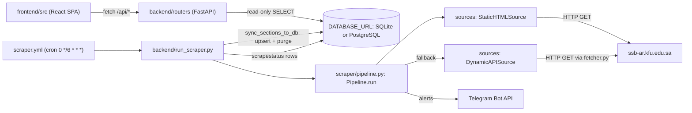

# KFU Scheduler Blueprint

## System Overview

KFU Scheduler (`جدولني`) builds conflict-free weekly timetables for King Faisal
University students. It has three parts:

- **Frontend** (`frontend/`): React 19 + Vite SPA, Arabic RTL, hosted on
  Firebase. It loads the catalog, sends the chosen courses to the API, and
  filters the results in the browser.
- **API** (`backend/` + `backend/routers/`): FastAPI + SQLModel. It serves the
  college → department → course catalog and generates schedules with
  backtracking.
- **Scraper** (`backend/scraper/` + `backend/run_scraper.py`): pulls sections
  from KFU (static HTML first, dynamic API as fallback) and syncs them into the
  database. GitHub Actions runs it every 6 hours.

Human-facing docs stay in [`README.md`](./README.md).

## Subdirectories & System Boundaries

- **backend**: [`./backend/EGM.md`](./backend/EGM.md) - DB engine and
  `init_db`, ORM tables (`college`, `department`, `course`, `section`,
  `scrapestatus`), FastAPI `app` with CORS, `SectionData` parser, Telegram
  helper, and the `run_scraper.py` CLI.
  - **routers**: [`./backend/routers/EGM.md`](./backend/routers/EGM.md) -
    `GET /api/colleges`, `GET /api/colleges/{college_id}/departments`,
    `GET /api/departments/{dept_id}/courses`, `POST /api/schedules/generate`,
    `GET /api/scraping/last-update`. Read-only.
  - **scraper**: [`./backend/scraper/EGM.md`](./backend/scraper/EGM.md) -
    `Pipeline`, `normalize_row`, `sync_sections_to_db`, `config`, legacy
    `fetcher` with `DEPARTMENT_MAP`.
    - **sources**:
      [`./backend/scraper/sources/EGM.md`](./backend/scraper/sources/EGM.md) -
      `Source` ABC, `StaticHTMLSource`, `DynamicAPISource`.
- **frontend**: [`./frontend/EGM.md`](./frontend/EGM.md) - npm scripts, Vite
  `/api` proxy, ESLint hook-export rule, Firebase hosting, `kfu-theme` pre-load
  script, deploy workflows.
  - **src**: [`./frontend/src/EGM.md`](./frontend/src/EGM.md) - `App` provider
    nesting and step switch, `uiText`.
    - **api**: [`./frontend/src/api/EGM.md`](./frontend/src/api/EGM.md) -
      `fetchColleges`, `fetchDepartments`, `fetchCourses`, `generateSchedules`,
      `fetchScrapeStatus`.
    - **contexts**:
      [`./frontend/src/contexts/EGM.md`](./frontend/src/contexts/EGM.md) -
      `ThemeProvider`, `UiTextProvider`, `ScheduleProvider` (filters and
      `filteredOptions`).
    - **hooks**: [`./frontend/src/hooks/EGM.md`](./frontend/src/hooks/EGM.md) -
      `useCourseCatalog`, `useScrapeStatus`.
    - **components**:
      [`./frontend/src/components/EGM.md`](./frontend/src/components/EGM.md) -
      `Header`, `Footer`.
      - **Step1**:
        [`./frontend/src/components/Step1/EGM.md`](./frontend/src/components/Step1/EGM.md) -
        course selection screen.
      - **Step2**:
        [`./frontend/src/components/Step2/EGM.md`](./frontend/src/components/Step2/EGM.md) -
        results, filters, week grid.

Not documented: `backend/tests/` (test-only), `backend/scraper/data/`
(generated JSON), `frontend/public/` and `frontend/src/assets/` (images only).

## Global Invariants

- **Shared API contract**: `[frontend/src/api/scheduleApi.js:generateSchedules]`
  sends `{course_ids, gender}`, matching
  `[backend/routers/schedules.py:ScheduleRequest]`. The response carries
  `time_slots` as an array of `{day, start, end}`.
- **Time format**: `[backend/models.py:Section.time_slots]` stores a JSON string
  of `{day, start, end}`. Days are Arabic letters (`ح ن ث ر خ`, Sunday to
  Thursday, no Saturday); times are zero-padded `HH:MM`. The frontend
  (`[frontend/src/components/Step2/WeekGrid.jsx:sectionsByDay]`) drops any
  other day value.
- **Status values**: `[backend/scraper/normalizer.py:STATUS_MAP]` maps raw
  availability to `متاحة` / `ممتلئة` / `غير متاحة`. The frontend matches these
  exact strings (`[frontend/src/contexts/ScheduleContext.jsx:filteredOptions]`,
  `[frontend/src/components/Step2/TimetableBlock.jsx:STATUS_CLASS]`).
- **Gender values**: stored as `"male"` / `"female"`
  (`[backend/schemas.py:parse_raw_university_data]`); the API filters by exact
  equality (`[backend/routers/schedules.py:generate_schedules]`).
- **String keys**: all IDs and `section_number` are strings; theory-to-practical
  linking (`[backend/routers/schedules.py:LINKING_RULES]`, colleges `09` and
  `07` only) does int math and pads back with `zfill(2)`.
- **Schema source of truth**: the live schema comes from SQLModel metadata via
  `[backend/database.py:init_db]`. `backend/schema.sql` is reference-only and
  mirrors the ORM (see [`./backend/EGM.md`](./backend/EGM.md)).
- **Single writer**: only the scraper writes catalog tables
  (`[backend/scraper/load_data.py:sync_sections_to_db]`); all API routes are
  read-only.
- **Purge guard**: stale rows are purged only when the new run has at least
  `PURGE_MIN_RATIO` of the existing sections, or with `--force-purge`
  (`[backend/scraper/load_data.py:sync_sections_to_db]`).
- **Dev wiring**: Vite proxies `/api` to `http://localhost:8000`
  (`[frontend/vite.config.js:server.proxy]`); production uses
  `VITE_API_BASE_URL` set in `firebase-hosting-merge.yml`.

## Global Side Effects

- **Database** (`DATABASE_URL`, default SQLite `backend/courses.db`;
  production PostgreSQL via `postgresql+psycopg2://`): DDL on API and CLI
  start, catalog upsert/purge and `scrapestatus` history from the scraper.
- **KFU servers** (`ssb-ar.kfu.edu.sa`): HTTP scraping by
  `StaticHTMLSource` and `fetcher.fetch_university_courses_data`.
- **Telegram Bot API**: warning and critical alerts from `Pipeline` and
  `run_scraper.py` when `TELEGRAM_BOT_TOKEN` and `ADMIN_CHAT_ID` are set.
- **Local disk**: `fetcher.py` writes `backend/scraper/data/` at import and
  during dynamic fetches.
- **Browser storage**: `localStorage['kfu-theme']`,
  `sessionStorage['kfu-scrape-status']` (5-minute cache).
- **CI/CD** (`.github/workflows/`): Firebase Hosting deploys on push to `main`
  and on PRs; the scraper runs every 6 hours on a self-hosted Linux runner.

## System Verification

- Backend (from `backend/`): `.venv\Scripts\python -m pytest tests/`
- Frontend (from `frontend/`): `npm run lint`
- Frontend build (from `frontend/`, Windows CMD/PowerShell only):
  `npm run build`
